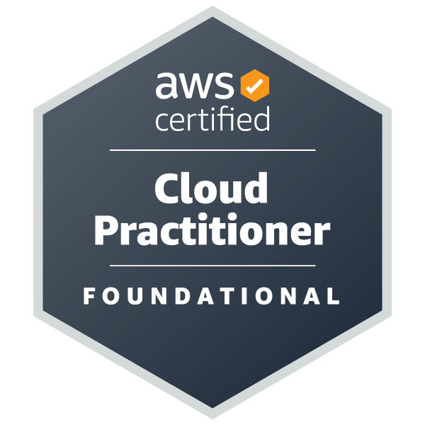
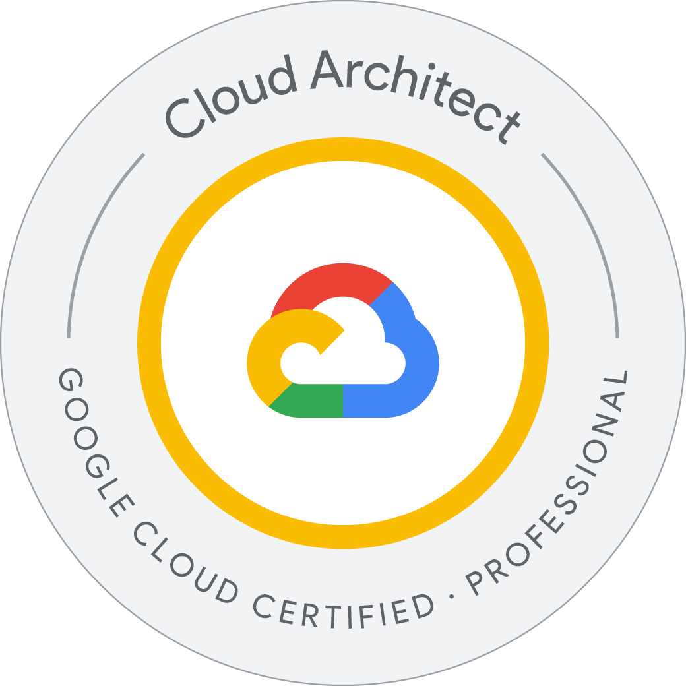

  

  

  

    Passionate about designing scalable cloud architectures, automating infrastructure, and building reliable DevOps workflows across <strong>AWS</strong> and <strong>Google Cloud Platform (GCP)</strong>.
  

  

    
    
    
    
  

 

## 🌩️ About Me

- ☁️ Designing and managing cloud-native solutions on **AWS** & **GCP**.
- 🚀 Automating infrastructure with **Terraform** and **Infrastructure as Code (IaC)**.
- 🐳 Building containerized workloads with **Docker** and **Kubernetes**.
- 🔄 Creating efficient **CI/CD pipelines** and deployment workflows.
- 📊 Monitoring, logging, and observability.
- 📬 Reach me at: **[winmani2323@gmail.com](mailto:winmani2323@gmail.com)**

 

## 🏆 Certifications

  
  &nbsp;&nbsp;&nbsp;&nbsp;&nbsp;&nbsp;
  

 

## 🧰 Tech Stack

<table>
  <tr>
    <td width="50%" valign="top">
      <h3 align="center">☁️ Cloud & Infrastructure</h3>
      

        
        
        
      

    </td>
    <td width="50%" valign="top">
      <h3 align="center">🚀 DevOps & CI/CD</h3>
      

        
        
        
        
        
        
        
      

    </td>
  </tr>
  <tr>
    <td width="50%" valign="top">
      <h3 align="center">📊 Monitoring & Observability</h3>
      

        
        
        
        
      

    </td>
    <td width="50%" valign="top">
      <h3 align="center">🛠️ Scripting & Automation</h3>
      

        
        
      

    </td>
  </tr>
</table>

 

  <blockquote>
    🧠 <em>“If you can’t measure it, you can’t improve it.”</em> 📊
      
    ☁️ <strong>Measure → Observe → Automate → Improve</strong> ⚡
  </blockquote>

